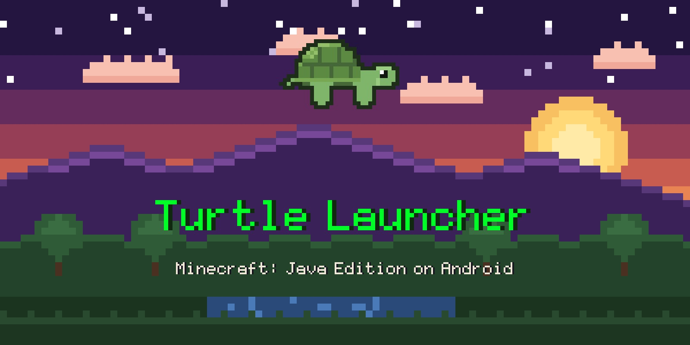

  

<h1 align="center">🐢 TurtleLauncher</h1>

  <strong>Your Minecraft. Your Device. Your Freedom.</strong>
   
  A modern, customizable Minecraft: Java Edition launcher for Android.
   
  🚀 Unmatched performance · 🌿 Customize everything

  
  

  
  
  
  
   
  
  
  

  
  

  

  <em>「 Every world has a story. Make yours extraordinary. 」</em>

---

## ✦ Navigation

  <a href="#-about-turtlelauncher">About</a> ·
  <a href="#-features">Features</a> ·
  <a href="#-screenshots">Screenshots</a> ·
  <a href="#-installation">Installation</a>
   
  <a href="#-built-with">Technology</a> ·
  <a href="#-roadmap">Roadmap</a> ·
  <a href="#-faq">FAQ</a> ·
  <a href="#-contributing">Contributing</a>

---

## 🌿 About TurtleLauncher

TurtleLauncher is an Android launcher for **Minecraft: Java Edition**, developed by **[Endiq](https://github.com/Endiq-jar)**.

Inspired by the possibilities of open-source Minecraft launchers, TurtleLauncher aims to bring a customizable, feature-rich Java Edition experience to Android devices.

From instance management and mod loaders to renderer options, Java runtimes, account management, and mobile-focused tools, TurtleLauncher brings together the features Minecraft players need in one place.

### ⚔️ Our vision

- 🎮 Make Minecraft: Java Edition more accessible on Android.
- 🌿 Deliver a clean, customizable launcher experience.
- 🧩 Support modded Minecraft and multiple game configurations.
- ⚡ Provide useful performance and runtime controls.
- 🛠️ Give players greater control over their installations.
- 💚 Build an open-source project that can grow with its community.

  

  Explore the world of TurtleLauncher.

---

## ✨ Features

### 🎨 Modern interface

- Material Design 3 interface.
- Dynamic themes and accent colors.
- Dark mode.
- Smooth animations and screen transitions.
- Responsive phone and tablet layouts.
- Gaming-inspired visual design.
- Custom backgrounds and UI scaling.

### ⚡ Performance and runtime controls

- Performance-focused launcher improvements.
- JVM and RAM configuration.
- Java runtime management.
- Renderer selection and configuration.
- MobileGlues renderer settings.
- Mesa3D and LTW renderer integrations.
- Launch and crash log inspection.

*Actual performance depends on device hardware, Android version, game version, renderer, drivers, mods, and configuration.*

### 🎮 Minecraft and mod-loader support

- Minecraft release versions.
- Snapshot, Beta, and Alpha versions where supported.
- Fabric.
- Quilt.
- Forge.
- NeoForge.
- Cleanroom integration.
- Multiple game instances.

*Compatibility varies by Minecraft version and loader. Check the current release and project documentation for supported configurations.*

### 📦 Content management

Manage supported Minecraft content from the launcher:

- Mods.
- Resource packs.
- Shader packs.
- Datapacks.
- Worlds.
- Screenshots.
- Logs.
- Modpack instances.
- Skin and cape management.

### ☕ Java management

- Manage compatible Java runtimes.
- Manual Java 8, 17, 21, and 25 downloads where supported.
- Package-signature checks for supported download workflows.
- Runtime selection for compatible Minecraft versions.
- JVM argument and memory configuration.

Not every Java version works with every Minecraft release. Select a runtime compatible with the game version and installed mods.

### 🔐 Account management

- Microsoft account integration.
- Offline accounts.
- Battly account integration.
- Ely.by account integration.
- Account management and supported authentication workflows.

Authentication availability and requirements depend on the selected provider and the current launcher implementation.

### 🛠️ Launcher tools

- Download Manager.
- Live launch logs.
- Crash diagnostics.
- Backup, import, and export.
- Content descriptions, galleries, versions, and changelogs where available.
- Customizable Discord Rich Presence, including version templates, status, timer, and artwork.
- In-game LWJGL tinyfd / NFD file-manager integration.
- Terracotta integration for supported multiplayer workflows.
- Friends and LAN play through Terracotta over EasyTier, including home-screen hosting and joining.
- App-wide screen transitions: slide, bounce, fade, and zoom.
- Emotes.
- Beryllium integration.

### 🔓 Optional Shizuku support

TurtleLauncher can use Shizuku-compatible functionality on supported Android devices.

Depending on the device, Android version, permissions, and implementation, this can include:

- One-tap permission assistance.
- All-files access and notification permission assistance.
- Battery-exemption assistance.
- Game process priority adjustments.
- Android 14+ phantom-process limit handling.
- System logcat access for diagnostics.
- Compatibility with Shizuku and Sui.

**Shizuku is optional.** Its availability and the permissions it can grant depend on Android restrictions, setup, and device configuration. TurtleLauncher can be used without it.

### 🎨 Customization and in-game tools

- Custom launcher backgrounds.
- UI scaling.
- Animation controls.
- Performance profiles.
- JVM and RAM settings.
- Renderer settings.
- In-game Dark Mode resource pack.

The in-game Dark Mode resource pack is intended to darken supported menus, buttons, and containers. The supplied implementation provides a toggle through the in-game Debug tab and resource-pack reload behavior.

---

## 🖼️ Screenshots

  <em>A look inside the TurtleLauncher experience.</em>

  

  More screenshots can be added here as the interface evolves.

## 📥 Installation

### Option 1 — Download a release

1. Open the [TurtleLauncher Releases](https://github.com/Endiq-jar/TurtleLauncher/releases) page.
2. Select the release you want to install.
3. Download the APK asset provided by that release.
4. Open the downloaded APK on your Android device.
5. Follow Android's installation prompts.

Only install APKs from sources you trust. Review release notes and verify available checksums or signatures when provided.

### Option 2 — Build from source

Developers can explore the repository and its build configuration:

1. Open the [TurtleLauncher repository](https://github.com/Endiq-jar/TurtleLauncher).
2. Read the project's build instructions and Gradle configuration.
3. Install the required Android development tools and compatible JDK.
4. Build using the project's documented Gradle tasks.
5. Install the resulting APK on a compatible test device.

The exact build commands and requirements depend on the current repository configuration.

---

## 🧰 Built With

TurtleLauncher uses technologies and projects from the Android, Java, and Minecraft ecosystems.

| Technology | Purpose |
|---|---|
| Kotlin and Java | Application and runtime integration |
| Jetpack Compose | UI framework |
| Material Design 3 | UI components and styling |
| AndroidX | Android application libraries |
| Coroutines and Flow | Asynchronous work and reactive data |
| Coil | Image loading |
| Lottie | Animation support |
| LWJGL 3 | Minecraft Java Edition native game libraries |
| GL4ES | Graphics compatibility |
| Mesa3D | Graphics drivers and rendering infrastructure |
| OpenJDK | Java runtime ecosystem |

Additional integrations include MobileGlues, LTW Renderer, Cleanroom, Terracotta, mclo.gs, Beryllium, Shizuku, and related open-source components.

Their inclusion does not imply that every component is enabled on every device or available in every release.

---

## 🎯 Project goals

TurtleLauncher aims to continually improve:

- ⚡ Faster launcher startup.
- 🧠 Efficient memory use.
- 🔋 Better battery efficiency.
- 🎮 Smooth gameplay and frame pacing.
- 🛡️ Stable launches and clearer crash diagnostics.
- 🧩 Better mod-loader and renderer compatibility.
- 📱 A consistent mobile user experience.
- 🌿 A maintainable and extensible codebase.

These are development goals, not guarantees of a particular FPS, launch time, temperature, or battery life.

---

## 🗺️ Roadmap

- [x] Modern UI.
- [x] Theme engine.
- [x] Instance Manager.
- [x] AI integration.
- [x] Performance improvements.
- [x] Mesa3D.
- [x] LTW Renderer.
- [x] MobileGlues Renderer.
- [x] Cleanroom integration.
- [x] Terracotta integration.
- [x] mclo.gs integration.
- [ ] Cloud Sync.
- [x] Skin and Cape Manager.
- [x] Turtle Client integration.
- [x] Real EGL implementation replacing OSMesa.
- [x] Shizuku support.
- [x] Beryllium integration.
- [x] Modpack instances.
- [x] Animations and transitions.
- [x] Emotes.

---

## ❓ FAQ

  
<strong>🛡️ Is TurtleLauncher safe?</strong>

  TurtleLauncher is an open-source project. You can inspect its source code and report potential security issues through GitHub. No software can be guaranteed completely risk-free.

  Download releases only from sources you trust.

  
<strong>💚 Is TurtleLauncher free?</strong>

  TurtleLauncher is distributed as an open-source project under the license specified in this repository. Check the official release page for downloads.

  
<strong>🧩 Does TurtleLauncher support Minecraft mods?</strong>

  TurtleLauncher includes support for selected mod loaders and content-management workflows. Compatibility depends on the Minecraft version, loader, mod, runtime, and graphics environment.

  
<strong>☕ Which Java versions are supported?</strong>

  Java 8, 17, 21, and 25 download workflows are listed among the project's features. The appropriate runtime depends on the Minecraft version and installed components.

  
<strong>📱 Does TurtleLauncher work on every Android device?</strong>

  No launcher can guarantee compatibility with every device. Results depend on Android version, CPU architecture, available memory, graphics drivers, renderer, and game configuration.

  
<strong>🔓 Is Shizuku required?</strong>

  No. Shizuku is optional. Some additional permissions or system-level features may require a compatible Shizuku or Sui setup.

  
<strong>🔐 Do I need a Microsoft account?</strong>

  TurtleLauncher lists Microsoft, offline, Battly, and Ely.by account workflows. The requirements depend on the selected account provider and the current implementation. Offline accounts do not grant ownership of paid Minecraft features or bypass official authentication requirements.

  
<strong>🐛 Where can I report bugs?</strong>

  Open an issue on GitHub and include:

  - Your Android version and device architecture.
  - The Minecraft version and Java runtime.
  - The selected renderer and mod loader.
  - Steps to reproduce the problem.
  - Relevant launch or crash logs.

  **[Open GitHub Issues →](https://github.com/Endiq-jar/TurtleLauncher/issues)**

---

## 🤝 Contributing

Contributions, bug reports, compatibility reports, documentation improvements, and feature suggestions are welcome.

### Ways to contribute

- 🐛 Report reproducible bugs.
- 💡 Suggest useful features.
- 🧩 Help investigate compatibility problems.
- 📚 Improve documentation.
- 🔧 Submit code improvements.
- 🧪 Test releases on different Android devices.
- ⭐ Star the repository if you find it useful.

### Pull request workflow

1. Fork the repository.
2. Create a branch for your change.
3. Make and test your changes.
4. Describe what changed and why.
5. Submit a pull request.

Please keep changes focused and include relevant testing information where possible.

  
  

---

## 📄 License

TurtleLauncher is identified in this project's documentation as licensed under **GNU General Public License v3.0 (GPL-3.0)**.

See the repository's [`LICENSE`](https://github.com/Endiq-jar/TurtleLauncher) file for the exact license terms.

---

## 💚 Credits and acknowledgements

TurtleLauncher builds on ideas, technologies, and open-source work from the Minecraft and Android communities.

Projects and technologies acknowledged by this README include:

- TurtleLauncher.
- HMCL.
- Boardwalk.
- OpenJDK.
- LWJGL.
- Mesa3D.
- GL4ES.
- MobileGlues.
- LTW Renderer.
- Cleanroom.
- Terracotta.
- mclo.gs.
- Beryllium.
- Shizuku.

Thanks to the maintainers, developers, testers, translators, and community members who help make open-source Minecraft on Android possible.

Third-party names and projects belong to their respective owners. Their inclusion does not necessarily indicate endorsement.

---

## ⚠️ Disclaimer

TurtleLauncher is an independent open-source project and is **not affiliated with, endorsed by, or sponsored by Mojang Studios or Microsoft**, unless explicitly stated otherwise by those companies.

Minecraft is a trademark of Mojang Studios. All relevant trademarks belong to their respective owners.

TurtleLauncher does not grant ownership of Minecraft. Users are responsible for complying with applicable software licenses and the terms of the services they use.

---

## 💚 Help grow TurtleLauncher

  <em>「 A small contribution today can create a whole new world tomorrow. 」</em>

  Every star, bug report, suggestion, and contribution helps the project grow.

  
  

  <a href="https://github.com/Endiq-jar/TurtleLauncher/issues">Report a bug</a>
  ·
  <a href="https://github.com/Endiq-jar/TurtleLauncher/network/members">Contribute</a>
  ·
  <a href="https://github.com/Endiq-jar">More projects by Endiq</a>

  

<h2 align="center">🐢 Thanks for visiting TurtleLauncher!</h2>

  <strong>One launcher. Endless possibilities.</strong>
   

  
    Made with 💚 by <a href="https://github.com/Endiq-jar">Endiq</a>
    and the open-source community.
  
   
  Open source · Android · Minecraft Java Edition

  

  

